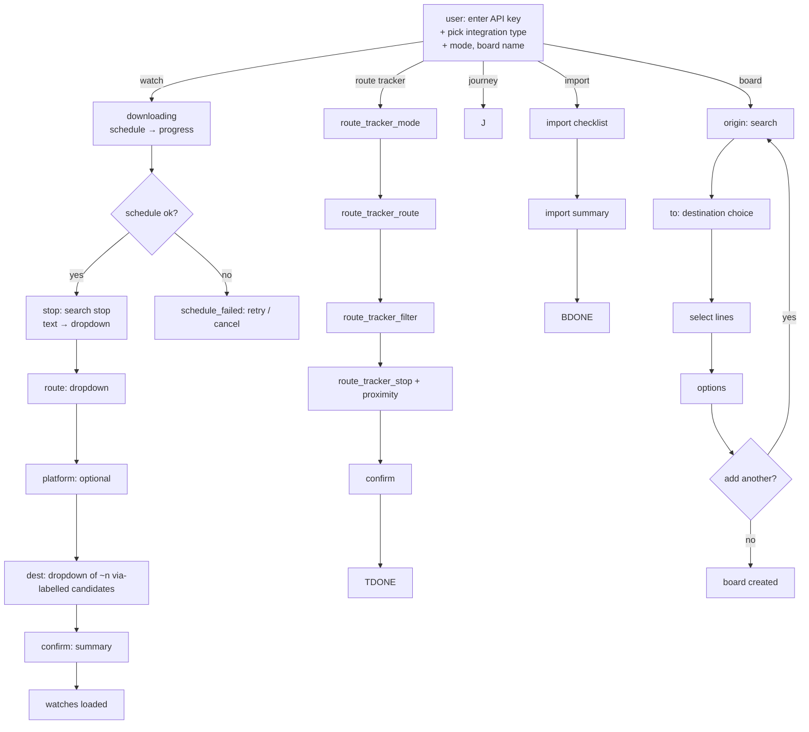
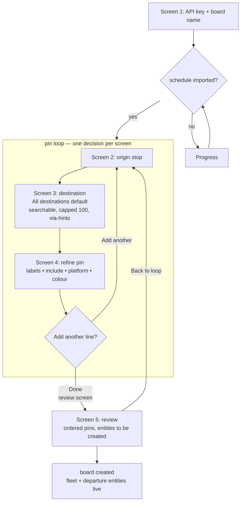
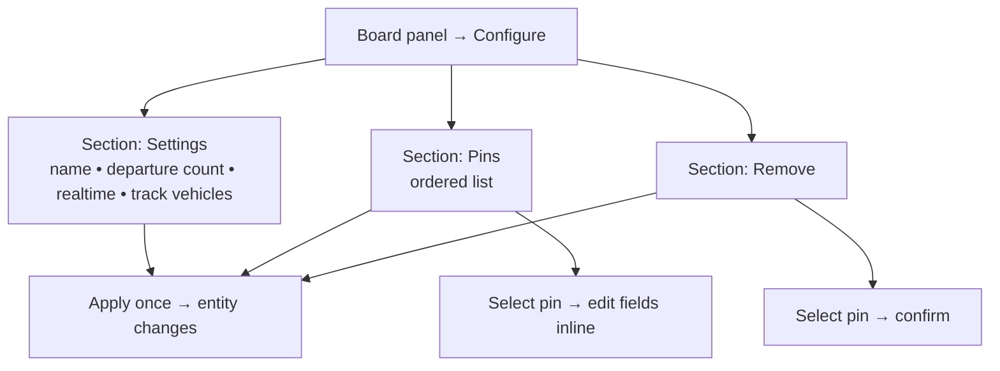

# Config Flow Design — current state, target UX, and the way there

**Status:** design document. Implement in the order of §6 (T18 packages).
**Audience:** maintainers, reviewers, and anyone who touches `config_flow.py` after this.
**Why this exists:** the config flow accumulated five separate patches (T7 destination step, T17
selectors, route-search removal, download progress, fleet option) with no map. This document is the
map. Every future config-flow change MUST update §3 (current state) and §5 (screens) in the same PR.

---

## 1. The whack-a-mole ledger (observed defects → root-cause classes)

| Observed (live) | Root cause class | Class ID |
|---|---|---|
| Radio-button wall of ~20 "X via Y" destination candidates | Lists rendered as LIST/LIST-ish forms regardless of length; no searchable dropdown | C1: list rendering |
| "Search routes" box that does nothing next to a dropdown | Vestigial field — a search companion pattern from an era where the list wasn't natively searchable | C1/C2 |
| Infinite "importing" spinner | Failure path of the background task wasn't surfaced (`False` result swallowed) | C3: failure surfacing |
| "Failed setup, will retry: Vehicle positions fetch failed: 404" | A *documented missing feed* raised as a hard error in a coordinator predating the feed taxonomy | C4: capability matrix not enforced at flow/UX layer |
| Board options = menu → sub-step → menu | Navigation sprawl; HA menus used where one form suffices | C5: step count / navigation |
| 3 screens to create a board, extra key re-typing | Steps not consolidated when data is already known | C5/C6: no state reuse |
| Destination labels duplicated ("Upfield Station via Gowrie" ×3) | Candidate collapse keyed on (direction, terminal, via) only | C7: candidate model |
| Vehicle tracker called "vehicle_vehicle_vehicle", latched to one trip | Legacy v0.1.0 entry type left in the flow with no capability gating | C4/C8: legacy surface |
| 286 MB download with zero progress feedback | Silent long operation, no progress API use | C3 |

**Rule going forward:** every fix must name its root-cause class (C1–C8) and update this document.
No more one-off patches without the map.

---

## 2. Constraints ledger (what Home Assistant 2026.x gives us / refuses)

These are facts, verified on 2026.2.3. Future design work must respect them — they are the reason
the target below looks the way it does.

1. **Subentries**: native API exists (`ConfigSubentryFlow`); *one subentry per flow run* — a
   "tick several lines at once" checkbox wall is NOT expressible. Multi-add = a loop of flows with
   an explicit "Add another line" menu (this is the TripView-recognisable loop) — or pre-ticked
   multi-select is impossible.
2. **Dropdown selectors** (`SelectSelector(mode=dropdown)`) are natively **searchable**, scrollable,
   and capped only by render sanity. Lists >6 entries → dropdown; ≤6 → LIST. (C1 fixed by policy.)
3. **Progress API** (`async_show_progress` + `progress_task` + `async_show_progress_done`) exists and
   works — long downloads must use it, and the task result must be *checked* before advancing (C3).
4. **Flow routing** resolves `async_step_<step_id>` — private helpers silently break at runtime
   while the light test env (which stubs the flow manager) stays green. Real-HA flow tests in
   `ptv-p12-harness` venv are mandatory for every config-flow PR. (C2 fixed by policy.)
5. **No back-stack**: HA flows have no native back button. Back = re-rendering a previous step with
   the state retained in `self._config`. Target UX uses this deliberately (see screens).
6. **Sections** in options flows can group settings; the options update triggers entry *reload* — so
   runtime-toggle-like options (direction select) must NOT live in options flows.
7. **Capability matrix is a fact** (§4): trams have no vehicle positions feed; bus service-alerts is
   a scope-limited product; V/Line has no service alerts. The flow must degrade gracefully and SET
   EXPECTATIONS in the step itself ("Live vehicle tracking is not available for trams").

---

## 3. Current state (as built today)

### 3.1 Step inventory (from `config_flow.py`)

| Flow class | Steps (current) |
|---|---|
| Main flow (watch / journey / import / route-tracker branches) | `user` (key+mode+name) → `downloading` → `schedule_failed` → `retry_download` → `importing` → `stop` → `route` → `platform` → `dest` → `journey` → `journey_dest` → `confirm` | 
| Route-tracker branch | `entry_type` → `route_tracker_mode` → `route_tracker_route` → `route_tracker_filter` → `route_tracker_stop` → `route_tracker_proximity` → `route_tracker_confirm` |
| Import branch | `entry_type` → `import` → `import_summary` → (subentry commit) |
| Board parent flow | `user` (entry type + board name) |
| Subentry (pin) flow | `origin` → `to` → `select_lines` → `options` → `add_another` → `finish` → `reconfigure` |
| Options flow (board/watch) | `init` (board_menu/watch_step) → `board_menu` (single form: settings/reorder/remove) → `board_settings` → `board_reorder` → `board_remove` |

### 3.2 Current flow map (verbatim)



### 3.3 Pain points per step (current → why it hurts)

| Current step | Pain |
|---|---|
| `dest` (watch + pin) | Candidates are a flat list ordered by (direction, terminal, via) — a CBD stop yields 20+ entries, some duplicates pre-T7, no grouping by direction, no "next train departing" preview to disambiguate |
| `select_lines` (board pin) | Only reachable when destination chosen; multi-add impossible (subentry API); "Add another line" menu feels like a detour |
| `route_tracker_route`/`stop` | Pre-T17: vestigial search box + big dropdown; post-T17 fixed, but mode step still forces a mode choice before any preview |
| `downloading`/`importing` | Fixed (progress + failure menu) in the download hotfix, but still only shows a spinner — no byte progress |
| `confirm` (watch) | The one summary screen, but it hides behind 5 steps; every fix so far added steps in front of it |
| Board options | Single-form `board_menu` (post-T17) still = "pick the thing you want from a dropdown" crawl |

---

## 4. Capability matrix by transport mode (verified live, 2026-11)

| Capability | Metro train | Tram | Metro+regional bus | V/Line regional |
|---|---|---|---|---|
| Schedule departures | ✅ | ✅ | ✅ (short workings → via-hints) | ✅ |
| Destination candidates from trip patterns | ✅ | ✅ (loop → via hints) | ✅ headsign dedup | ✅ |
| Realtime delays / cancellations | ✅ | ✅ | ✅ | ✅ |
| Service alerts | ✅ | ✅ | ⚠️ product-scope (403 — enable under My Account) | ❌ not published |
| Live vehicle positions | ✅ | ❌ not published (undocumented endpoint exists but unconsumed) | ✅ (combined incl. regional) | ✅ (headers may lag) |
| Fleet device trackers | ✅ | ❌ (capability, documented) | ✅ (route-scoped, cap 30) | ✅ |
| Journey (multi-leg) | ✅ | ✅ | ✅ | ✅ |

**Rule:** every step that offers a mode-dependent thing must read THIS matrix — not developer
memory. Vehicle-tracking toggles are hidden for tram entries; service-alert sensors for V/Line
watch are omitted with a step-level note; the regional-bus wording says "bus (incl. regional)".

---

## 5. Target UX (screens and behaviour)

### 5.1 Principles

1. **Search-first, dropdown-second** — every list >6 entries is a searchable dropdown (never radio).
2. **One decision per screen** — origin, destination, refinement, confirm. No screen asks two unrelated things.
3. **Summaries end flows** — every multi-step flow ends with a review screen showing everything that will be created, exactly as TripView's save does.
4. **Capability-aware** — options that don't apply to the chosen mode are hidden with a sentence, never shown and broken.
5. **The download is a first-class screen** — progress + percentage + failure menu, never a spinner void.
6. **Pins are the board** — board creation's job is producing good pins; pin add/edit/remove/reorder lives in ONE management screen with sections.

### 5.2 Target: create a watch

```mermaid
flowchart TD
    A[Screen 1: API key\n+ integration name\nprefill key if another entry exists] --> B{schedule imported?}
    B -->|no| P[Progress: schedule download\n% + MiB, failure menu] --> B
    B -->|yes| C[Screen 2: origin stop\nsearchable dropdown]
    C --> D[Screen 3: destination\nAll destinations (default)\nsearchable candidates w/ via-hints\ngrouped by direction ordering]
    D --> E[Screen 4: refine\nplatform filter • labels • colour\ntrack vehicles if capability ✅]
    E --> F[Screen 5: review\nline, direction, destination, stop, labels, options\n= exactly the created entities]
    F -->|Back| D
    F --> DONE[entry created\nentities live immediately]
```

Screen 4 hides "track vehicles" for tram watches with the sentence: "Live vehicle positions are not published for trams."

### 5.3 Target: create / manage a board



### 5.4 Target: manage an existing board (options)



Use options-flow **sections** (one flow instance, grouped fields) instead of the `board_menu`
dropdown hop. Removal keeps its confirm step.

### 5.5 Target: journey / route tracker / import

- **Journey**: origin → transfer/destination → per-leg refinement → review. Same screens as a
  board pin, times legs. Searchable everything, review at the end.
- **Route tracker**: collapse 6 steps → 3 (mode+route combined into one screen with grouped
  dropdown; stop + proximity combined into one screen with a radius number field; review).
- **Import**: checklist → summary → *board review screen* (not just "done"). Import preview must
  show the pins that WILL be created, clickable.

---

## 6. Work packages (T18: the closing-gap set)

| Package | Scope | Acceptance | Effort |
|---|---|---|---|
| **T18.1 — selectors everywhere (C1)** | Stop/route/destination lists → dropdown selectors; ≤6 stays list. Remove dead search companions | No long list renders as radio; grep rule: `SelectSelectorMode.LIST` + `options>6` = lint error (script) | S |
| **T18.2 — destination grouping (C7)** | Candidates ordered by direction, terminal, via; duplicates collapsed by label (lands with T7 follow-up); cap 100 with "search to narrow" hint; direction shown in every label | Destination screen shows ≤100 searchable options, grouped visually, no duplicates ever | M |
| **T18.3 — review screens (C5)** | Watch + board + journey + import end in a summary screen listing exactly what will be created | Review screens golden-tested (snapshot the rendered schema + values) | M |
| **T18.4 — progress with percentage (C3)** | Downloader emits per-chunk progress → show `N MiB / X MiB (yy%)`; failure menu stays | Progress screen shows numbers for the real 286 MB download | S |
| **T18.5 — capability-gated options (C4)** | Mode-matrix driven: tram hides vehicle toggle w/ explanation; V/Line hides alerts expectations; bus notes the product-scope sentence | Toggling impossible for unsupported capabilities; step note visible | M |
| **T18.6 — options-flow sections (C5)** | Board/watch options → sections (Settings / Pins / Remove); remove the menu hop | Options flow is one surface, sub-steps routed internally, real-HA tests green | M |
| **T18.7 — route tracker collapse (C5)** | 7 steps → 3 + review | Step count asserted in test | S |
| **T18.8 — legacy surface removal (C8)** | `vehicle_tracker` entry type no longer offered (already done in T16-UI); legacy `route_tracker` gets an updated screen set; naming artifacts fixed | No deprecated screens reachable from the flow menu | S |

**Order:** T18.1 → T18.2 → T18.4 → T18.5 → T18.3 → T18.6 → T18.7 → T18.8. Each lands with
real-HA flow tests (mandated, §2.4) and an update to §3 and §5 of this document.

---

## 7. What "done" looks like

A user walks: paste key → search stop → pick destination → glance at review → done, in **under a
minute per pin**, without reading a single label twice, without a spinner they can't interpret, and
without ever being shown a broken option for their transport mode. The board is one screen with
sections. Every screen answers one question. And nothing in §1's ledger can recur, because each
class has a named rule in §2 and a package in §6.
